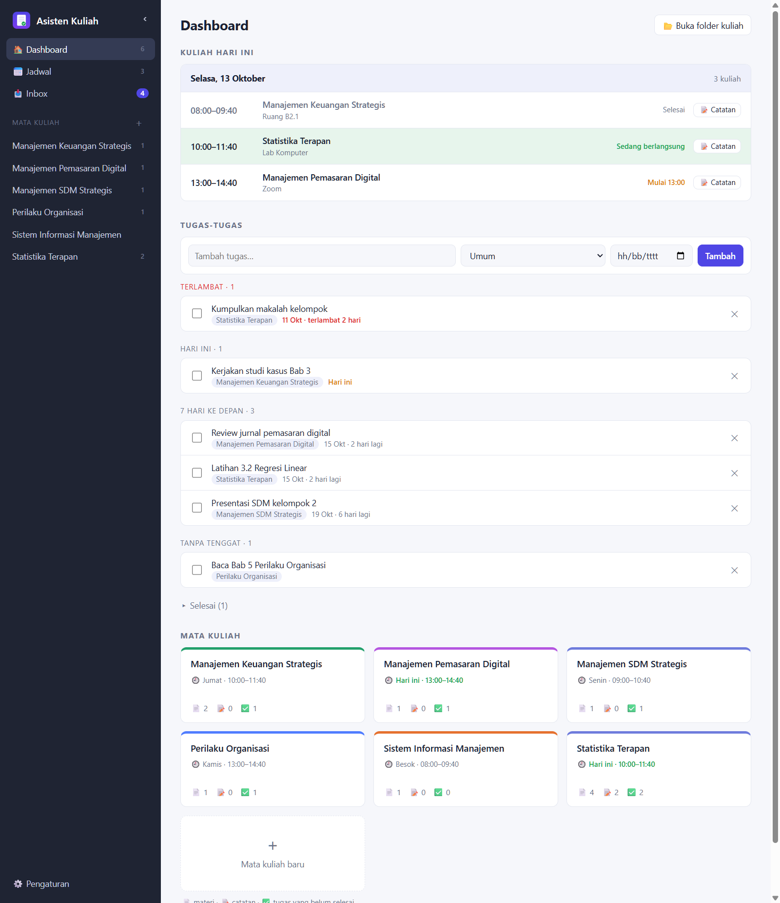
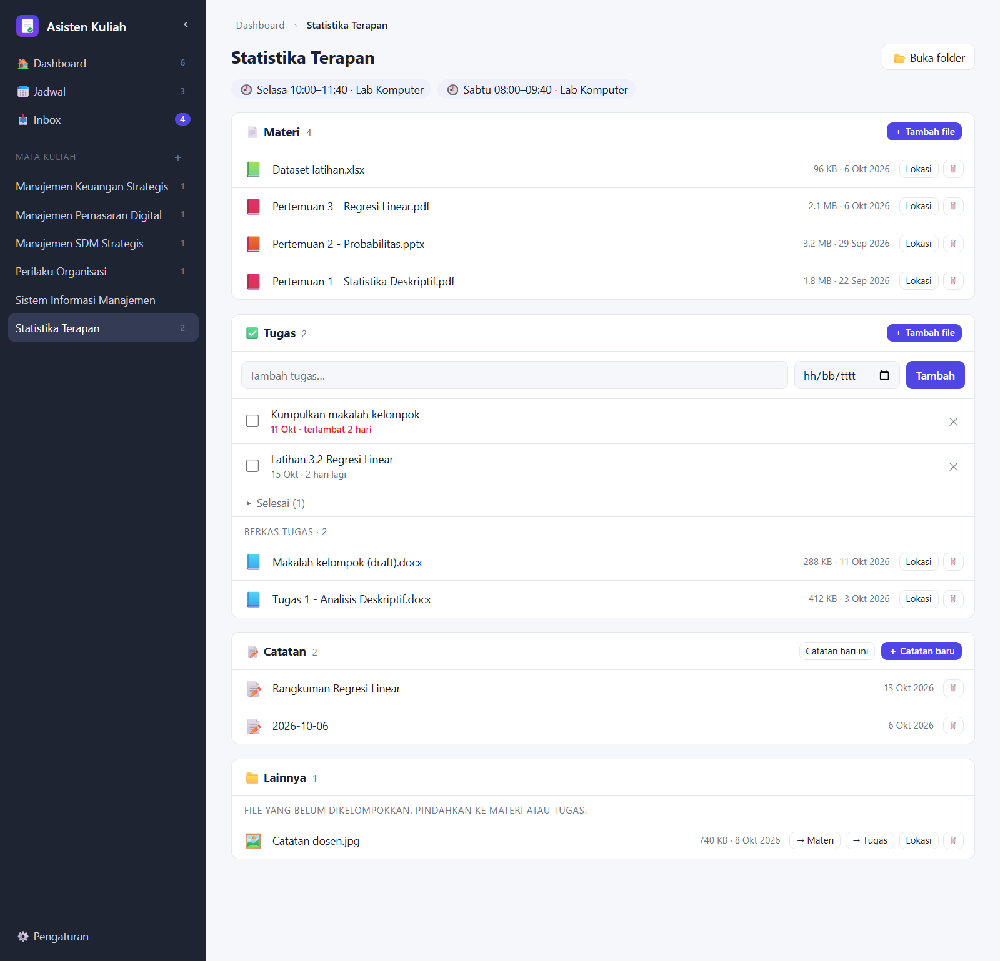
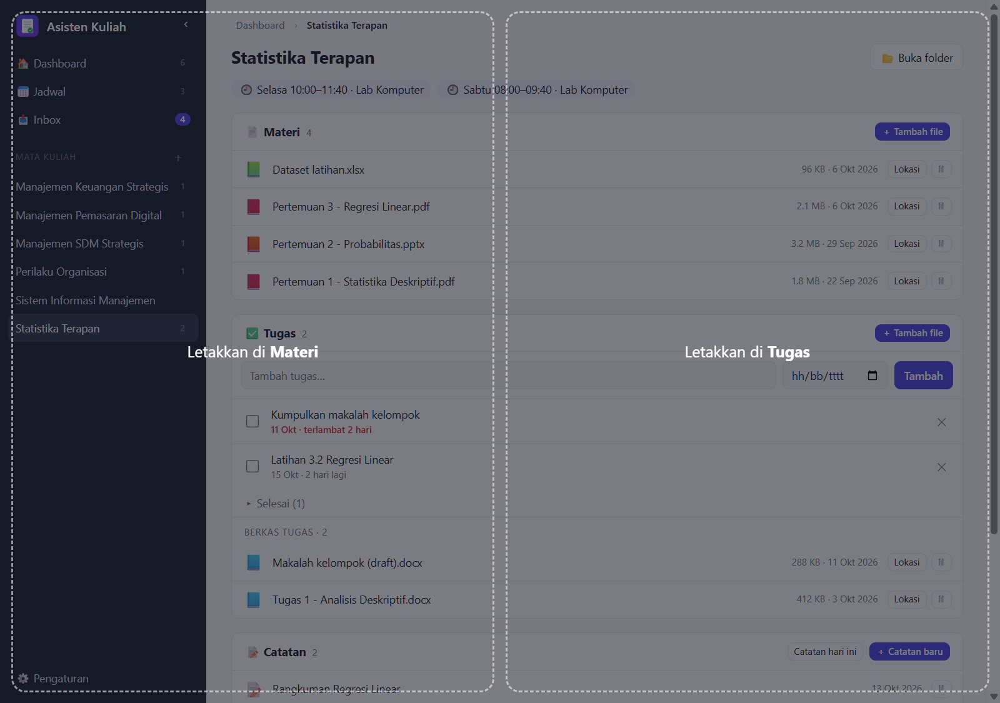
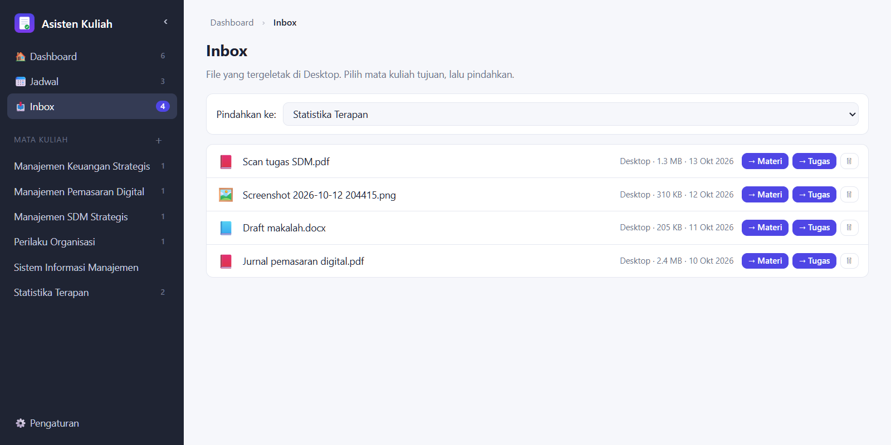
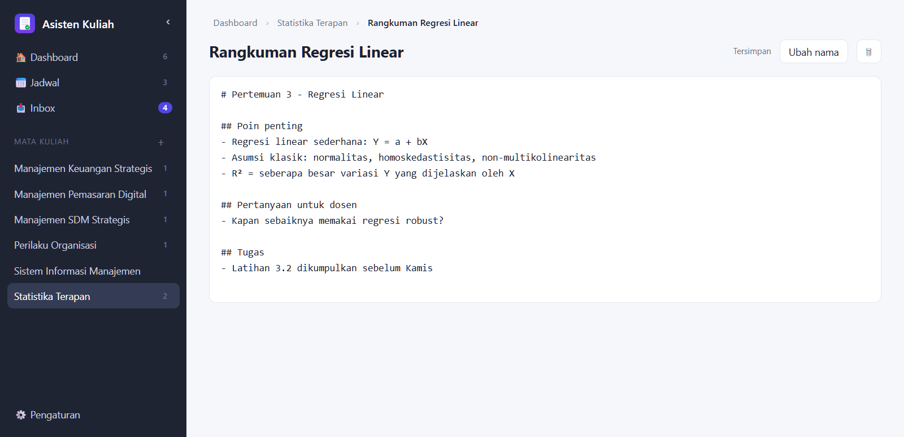
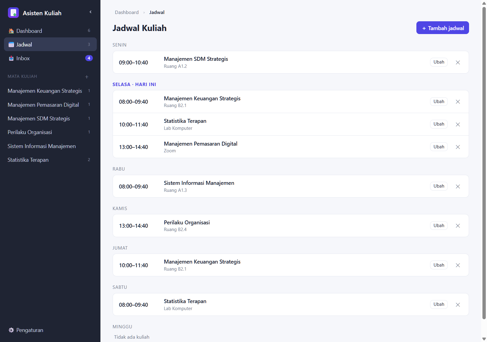
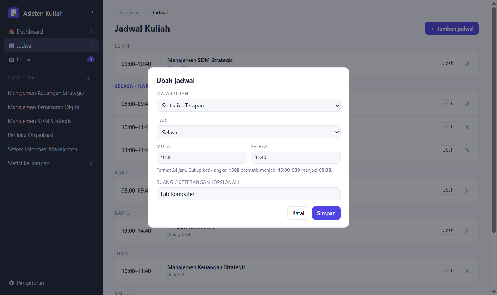
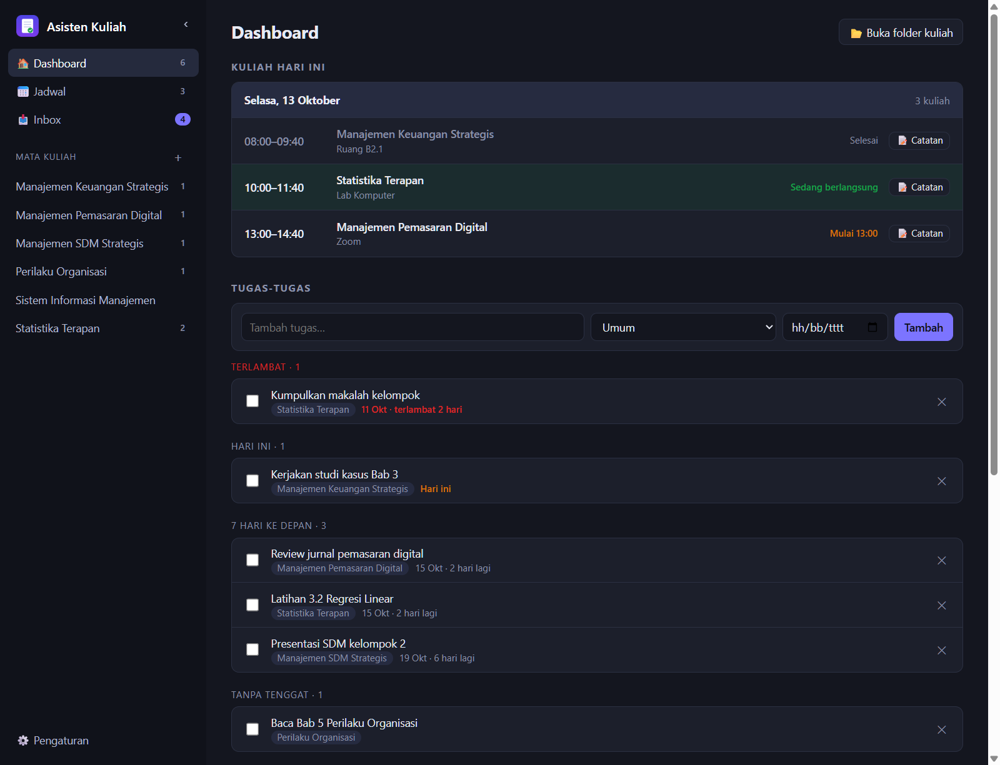
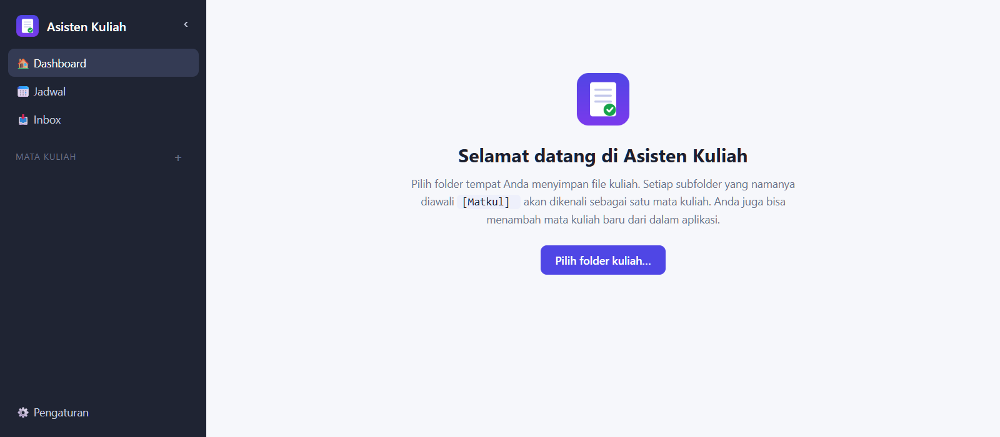

<div align="center">


# Asisten Kuliah

**Satu tempat untuk jadwal, tugas, materi, dan catatan kuliah — langsung di folder Anda sendiri.**


</div>

> 🇬🇧 **In short:** a lightweight Windows desktop app (Electron, no UI framework) that organises university coursework — today's classes, to-dos, per-course materials, assignments and Markdown notes — as plain files and folders you already own. Everything stays on your disk; there is no account, server or telemetry. The interface is in Indonesian.

<p align="center">
  
</p>

---

## Daftar isi

- [Kenapa aplikasi ini ada?](#kenapa-aplikasi-ini-ada)
- [Fitur](#fitur)
- [Panduan penggunaan](#panduan-penggunaan)
- [Cara file disimpan](#cara-file-disimpan)
- [Instalasi](#instalasi)
- [Menjalankan dari source](#menjalankan-dari-source)
- [Pintasan & tips](#pintasan--tips)
- [Privasi & keamanan](#privasi--keamanan)
- [Teknologi & struktur proyek](#teknologi--struktur-proyek)
- [Batasan saat ini](#batasan-saat-ini)

## Kenapa aplikasi ini ada?

File kuliah sering berakhir di Desktop karena membuka folder yang tersusun rapi tapi "dalam" terasa merepotkan:
`Kuliah › Semester › Nama Mata Kuliah › Materi › …`

Asisten Kuliah menghilangkan gesekan itu. Anda cukup **seret file ke jendela aplikasi** (atau pindahkan dari **Inbox**), dan file langsung masuk ke folder mata kuliah yang benar. Di atas folder itu, aplikasi menambahkan jadwal, daftar tugas, dan catatan.

## Fitur

### 🏠 Dashboard sebagai halaman awal

Begitu aplikasi dibuka, Anda langsung melihat:

1. **Kuliah Hari Ini** — jam, ruang, dan status (*Selesai*, *Sedang berlangsung*, *Mulai 13:00*).
2. **Tugas-Tugas** — to-do dengan tenggat, otomatis dikelompokkan: *Terlambat*, *Hari ini*, *7 hari ke depan*, *Nanti*, *Tanpa tenggat*.
3. **Mata Kuliah** — card per mata kuliah berisi jadwal terdekat serta jumlah 📄 materi, 📝 catatan, dan ✅ tugas yang belum selesai.

### 📚 Halaman per mata kuliah

Klik sebuah card untuk membuka halamannya, berisi tiga grup:

| Grup | Isi |
|---|---|
| 📄 **Materi** | File materi kuliah (PDF, slide, dataset, …) |
| ✅ **Tugas** | Daftar tugas (to-do) mata kuliah itu + berkas tugasnya |
| 📝 **Catatan** | Catatan pribadi berformat Markdown |

File lama yang masih tercampur di folder mata kuliah muncul di grup **📁 Lainnya** dan bisa dipindahkan ke Materi/Tugas dengan satu klik. Breadcrumb di atas halaman (`Dashboard › Mata Kuliah › Catatan`) memudahkan berpindah naik-turun.

<p align="center">
  
</p>

### 🖱️ Seret & lepas — tanpa membuka folder

Seret file dari mana saja ke jendela aplikasi saat membuka sebuah mata kuliah, lalu lepaskan di zona **Materi** atau **Tugas**. File disalin ke subfolder yang benar.

<p align="center">
  
</p>

### 📥 Inbox untuk file yang menumpuk

Inbox menampilkan file yang tergeletak di Desktop (atau folder lain yang Anda tambahkan, misalnya Downloads). Pilih mata kuliah tujuan, lalu klik **→ Materi** atau **→ Tugas** — file *dipindahkan*, jadi Desktop Anda kembali bersih.

<p align="center">
  
</p>

### 📝 Catatan pribadi (Markdown)

Setiap catatan adalah file `.md` biasa di folder `Catatan` mata kuliah. Tersimpan **otomatis** saat Anda mengetik. Tombol **Catatan hari ini** membuat (atau membuka) catatan bernama tanggal hari itu — dan di kartu *Kuliah Hari Ini* ada pintasan 📝 langsung ke sana.

<p align="center">
  
</p>

### 📅 Jadwal kuliah

Atur jadwal mingguan: mata kuliah, hari, jam mulai/selesai, dan ruang (opsional). Jam memakai **format 24 jam** dan cukup diketik sebagai angka: `1500` otomatis menjadi `15:00`, `930` menjadi `09:30`. Dari jadwal inilah kartu *Kuliah Hari Ini* dan jadwal terdekat di tiap card mata kuliah dihitung.

<table>
  <tr>
    <td width="50%"></td>
    <td width="50%"></td>
  </tr>
</table>

### 🎨 Lainnya

- **Tema terang & gelap** otomatis mengikuti pengaturan Windows.
- **Sidebar bisa disembunyikan** (tombol `‹` atau <kbd>Ctrl</kbd>+<kbd>B</kbd>) untuk ruang kerja lebih luas. Pilihan Anda diingat.
- **Hapus aman**: menghapus file/catatan memindahkannya ke Recycle Bin, bukan menghapus permanen.
- **Sinkron otomatis** dengan perubahan di Explorer: jika Anda menambah file lewat Explorer, tampilan aplikasi ikut diperbarui.

<p align="center">
  
</p>

## Panduan penggunaan

### 1. Pertama kali membuka aplikasi

Pilih folder tempat Anda menyimpan file kuliah. Setiap subfolder yang namanya diawali **`[Matkul] `** akan dikenali sebagai satu mata kuliah. Belum punya? Pilih folder kosong, lalu tambahkan mata kuliah dari dalam aplikasi.

<p align="center">
  
</p>

### 2. Tambahkan mata kuliah

Klik **＋** di samping *Mata Kuliah* pada sidebar (atau card **＋ Mata kuliah baru** di Dashboard) dan ketik namanya. Aplikasi membuat folder `[Matkul] Nama` untuk Anda.

### 3. Atur jadwal

Buka menu **📅 Jadwal → ＋ Tambah jadwal**, pilih mata kuliah, hari, dan jam. Selesai — Dashboard otomatis menampilkan kuliah hari ini.

### 4. Masukkan materi dan tugas

Pilih salah satu cara:

| Cara | Langkah |
|---|---|
| **Seret & lepas** | Buka mata kuliah → seret file ke jendela → lepaskan di zona *Materi* atau *Tugas* |
| **Tombol** | Di grup yang diinginkan, klik **＋ Tambah file** dan pilih file |
| **Inbox** | Buka **📥 Inbox** → pilih mata kuliah tujuan → klik **→ Materi** / **→ Tugas** |

### 5. Catat saat kuliah berlangsung

Di Dashboard, klik **📝 Catatan** pada kuliah yang sedang berjalan. Ketik — tidak perlu menekan simpan. Buat catatan tambahan lewat **＋ Catatan baru**.

### 6. Kelola tugas

Tambahkan tugas dari Dashboard (pilih mata kuliah dan tenggat) atau dari halaman mata kuliah. Centang untuk menandai selesai; tugas yang selesai disembunyikan di bawah *Selesai*.

## Cara file disimpan

Aplikasi tidak memakai database tersembunyi. Semuanya file dan folder biasa yang bisa Anda buka di Explorer:

```text
Kuliah/                                  ← folder kuliah yang Anda pilih
├── [Matkul] Statistika Terapan/
│   ├── Materi/                          ← file materi
│   ├── Tugas/                           ← berkas tugas
│   └── Catatan/
│       ├── 2026-10-13.md                ← catatan Markdown
│       └── Rangkuman Regresi Linear.md
├── [Matkul] Manajemen Keuangan Strategis/
│   └── …
└── .asisten-kuliah/
    └── data.json                        ← daftar tugas (to-do) & jadwal
```

Pengaturan aplikasi (folder kuliah dan folder Inbox) disimpan terpisah di `%APPDATA%\asisten-kuliah\settings.json`.

Karena semuanya berupa file, Anda bebas menaruh folder kuliah di OneDrive/Dropbox/Google Drive untuk sinkronisasi dan backup, atau memasukkannya ke Git.

## Instalasi

### Opsi A — Pasang installer (disarankan)

1. Buka halaman **Releases** repositori ini dan unduh `Asisten Kuliah Setup x.y.z.exe`.
2. Jalankan installer. Aplikasi akan muncul di **Start Menu** dan bisa di-pin ke taskbar.

> **Catatan:** installer belum ditandatangani secara digital, jadi Windows SmartScreen mungkin menampilkan peringatan. Pilih **More info → Run anyway**. Kode sumbernya terbuka di repositori ini jika Anda ingin memeriksanya, atau bangun sendiri (Opsi B).

### Opsi B — Bangun sendiri

Lihat bagian berikutnya.

## Menjalankan dari source

Prasyarat: [Node.js](https://nodejs.org) 20 atau lebih baru.

```bash
git clone <url-repositori-ini>
cd Asisten_kuliah
npm install

npm start        # jalankan aplikasi (mode pengembangan)
npm run dist     # bangun installer Windows ke folder dist/
```

Hasil `npm run dist` adalah `dist/Asisten Kuliah Setup x.y.z.exe` (±86 MB, ukuran standar Electron).

## Pintasan & tips

| Aksi | Cara |
|---|---|
| Sembunyikan / tampilkan sidebar | Tombol `‹` / `☰`, atau <kbd>Ctrl</kbd>+<kbd>B</kbd> |
| Buka folder mata kuliah di Explorer | Tombol **📂 Buka folder** di halaman mata kuliah |
| Tampilkan sebuah file di Explorer | Tombol **Lokasi** pada baris file |
| Ubah folder kuliah / folder Inbox | **⚙️ Pengaturan** di sidebar |
| Ubah nama / hapus catatan | Tombol **Ubah nama** / 🗑 di editor catatan |

Tips: tambahkan folder **Downloads** ke Inbox lewat Pengaturan agar file unduhan ikut terpantau.

## Privasi & keamanan

- **100% lokal.** Aplikasi tidak membuat koneksi jaringan, tidak punya akun, dan tidak mengirim telemetri. Data Anda hanya ada di disk Anda.
- Antarmuka berjalan dengan `contextIsolation` dan `sandbox` aktif serta *Content-Security-Policy* yang ketat (tanpa skrip atau gaya inline, tanpa sumber eksternal).
- Semua operasi file di sisi proses utama **dibatasi pada folder yang Anda kelola** (folder kuliah dan folder Inbox). Path di luar itu, nama catatan yang mencoba keluar folder (`..\`), dan nama mata kuliah yang tidak valid ditolak.
- Menghapus selalu lewat Recycle Bin.

## Teknologi & struktur proyek

Electron + HTML/CSS/JavaScript polos. Tanpa framework UI, tanpa bundler, hanya dua *devDependency* (`electron`, `electron-builder`).

```text
.
├── main.js            # proses utama: jendela, akses file, IPC, pemantau folder
├── preload.js         # jembatan aman (contextBridge) antara UI dan proses utama
├── renderer/
│   ├── index.html
│   ├── style.css      # tema terang/gelap lewat CSS variables
│   ├── app.js         # seluruh logika UI (dashboard, mata kuliah, catatan, jadwal, inbox)
│   └── logo.png
├── build/icon.png     # ikon aplikasi & installer
└── docs/images/       # screenshot untuk README
```

## Batasan saat ini

- Dikembangkan dan diuji di **Windows 11**; belum diuji di macOS/Linux.
- Editor catatan berupa teks polos (belum ada pratinjau Markdown).
- Belum ada notifikasi pengingat untuk tenggat atau jadwal kuliah.
- Antarmuka hanya tersedia dalam Bahasa Indonesia.
- Jadwal berulang mingguan saja (belum mendukung jadwal per tanggal tertentu).

Ide dan perbaikan dipersilakan lewat *issue* atau *pull request*.
